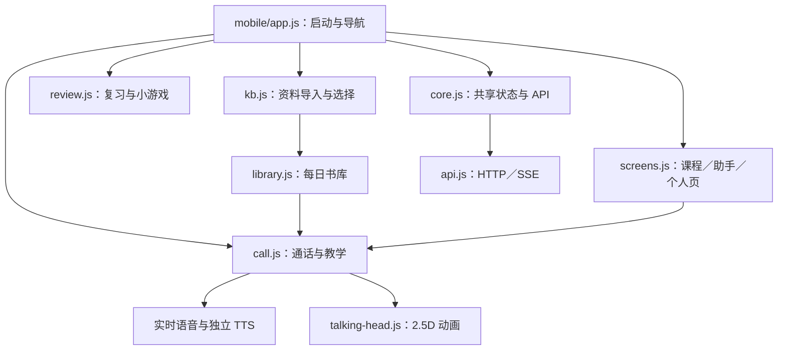

# Ava 前端逆向审查（只读）

审查范围：用户交接包解压后的 `仓库根目录`；没有修改原源码，没有外呼模型或语音服务，没有用 shell 操作浏览器。本文的行号以该原始包为准。浏览器交互、API 整体回归由主代理另行验收。

## 1. 结论

**核心前端源码齐全，可以继续开发；当前是一套功能较丰富的本地单用户学习产品原型，不是只有页面的空壳，也还不是完成账号、付费、同步与正式语音质量验证的线上产品。**

主入口是 `/mobile`，但“mobile”只是历史目录名：其界面已扩展为桌面沉浸式人物背景、五个 Tab 和通话覆盖层。旧入口 `/` 仍是完整的另一套教学界面，且模型和语音凭据设置仍只存在于旧入口。这是目前最直接的新用户上手断点。

本次前端侧查到四项高置信缺陷：主界面没有密钥配置入口；书库第 6 天不能自动换书；知识库读取失败会被显示成空库；难度保存失败仍提示成功。书库和知识库错误已用隔离内存环境执行源码函数复现。

## 2. 完整性核验与覆盖

- `web/` 有 20 个 JS 文件、27,067 行、1,026,067 字节；全部 `node --check` 通过（Node v24.22.1）。
- 去除注释后，实际静态与字面量动态 import 共 38 条，目标均存在。
- 初扫曾报告 `web/avatar/avatar.js` 的 `./avatar/avatar.js` 不存在，经核查只是顶部用法说明注释，不是运行依赖。
- HTML/CSS/JS 中字面量静态素材路径没有发现缺失。人物三张 JPG、对应 SVG、六张前后景 WebP、motion.json、应用图标均在包内。
- active `/mobile` 的 import 图包含 13 个 JS 模块，总大小约 686 KB（含按需动态加载模块）；另通过 AudioWorklet 运行时 URL 加载 `web/js/pcm-worklet.js`，该文件存在，代码位置 `doubao-voice.js:1050–1055`。
- 8 个 CSS 文件共 7,406 行；主入口实际加载 mobile.css、review.css、glass.css、call-redesign.css、library.css 五层样式。
- `web/js/mobile/games.js` 没有被当前 mobile import 图引用，是旧“趣玩”实现；现有三款小游戏在 review.js 中。
- `web/js/store.js` 服务于旧版 main.js，当前 mobile 采用 core.js 的 M 对象和各模块自己的状态。这不是缺文件，是两套状态层并存。
- 本包没有 Service Worker 注册；manifest 提供安装/独立窗口元信息，不能据此认定已经有完整离线 PWA。
- 缺少的历史截图属于打包说明明确排除项，前端核心运行不依赖这些截图。不能从缺截图推断产品代码丢失。

### 前端文件职责表

| 文件 | 实际职责 | 状态 |
|---|---|---|
| web/mobile.html | 五 Tab 外壳、通话/资料面板、弹层、麦克风诊断 DOM | 活跃主入口，完整 |
| mobile/app.js | 并行启动加载、导航、返回键、跨模块 ui 注册、QA 接口 | 活跃 |
| mobile/core.js | M 全局状态、转义、角色 fallback、API 包装、计划缓存 | 活跃 |
| mobile/screens.js | 课程、角色选择、助手、个人页 | 活跃，缺凭据设置入口 |
| mobile/call.js | 课程/对话/资料课、PTT、字幕、口播、断点与总结 | 活跃，4,438 行集中状态机 |
| mobile/kb.js | 上传、网页导入、粘贴、OCR 校对、列表、选择资料、进入讨论 | 活跃，错误状态缺陷 |
| mobile/library.js | 每日节选安排、书籍切换、入库、完成、词汇同步 | 活跃，跨日轮换缺陷 |
| mobile/book-library.js | 六本书、每本五日节选的静态内容 | 活跃 |
| mobile/review.js | SRS 卡片、四档自评、词库管理、三种小游戏 | 活跃，2,534 行 |
| mobile/voice-audio.js | 独立角色 TTS 请求、Blob 音频播放、20 条内存缓存 | 活跃 |
| mobile/games.js | 旧版“趣玩”词语配对 | 当前未引用 |
| api.js | JSON API、异常映射、超时、SSE 流解析、API 方法集合 | 两套界面共享，2,493 行 |
| speech.js | 浏览器 STT、TTS、语言判断、语音块调度 | 两套界面共享 |
| doubao-voice.js | 前端实时语音、PCM 采集/播放、WS、门限/状态控制 | 按需加载 |
| pcm-worklet.js | AudioWorklet 音频处理与重采样 | 按需运行 |
| talking-head.js | WebGL 分层图片动画、眨眼、口型/呼吸、静态图兜底 | mobile 使用 |
| index.html/main.js | 旧桌面版五模式、设置、统计、引导 | 仍可访问；配置功能依赖它 |
| modes.js | 旧版自由聊天、词汇、跟读、角色扮演、阅读讲解 | 旧版 |
| store.js | 旧版缓存、进度合并、失败待提交队列 | 旧版 |
| ui.js | 旧版 DOM、弹窗、转义、教练反馈、统计 | 旧版 |
| avatar/avatar.js + CSS | 旧版 SVG 数字人和口型时间线 | 旧版；完整 |
| design-preview/*.html | 多套静态设计试验页 | 展示参考，非产品主流程 |

## 3. 主前端结构与用户路径



### 路径 A：计划与课程

助手文字输入 → `/api/assistant` → 收到 create_plan/update_plan → 课程页显示 generating 状态并每两秒轮询计划 → 三课列表 → 选择老师 → 通话内跟读/练习/挑战 → 保存断点/完成。

证据：`screens.js:128–156` 轮询；`:224–242` 打开课程；`:244–310` 选老师/重开/重试；`:1091–1148` 助手动作；`call.js:408–459` 装载课程；`:589–710` 课程规则和断点。

已经有生成中、生成错误、重试、ready、断点恢复，属于实际实现。弱点在“通关”指标：跟读采用转写文本词面匹配；连续两次不匹配也放行；练习两轮进入挑战，挑战命中句型或两轮便完成。这支持练习流程，不足以证明发音准确或学习掌握。

### 路径 B：自由对话

角色画廊选 Elena/Maya/Hikari → 打开全屏通话 → 麦克风诊断/PTT 或文字输入 → 实时语音或 `/api/chat` SSE → 双语字幕/角色动画 → 快速总结 → AI 总结替换 → 单词表与复习。

证据：`screens.js:846–920`；`call.js:1807–1968`；`:3846–3919`；`:4068–4124`。

已经实现麦克风环境识别、静音、输入切换、翻译、历史记录、挂断总结。手机真机/弱网/切后台等结果必须用实测补足，不能从代码存在推断语音稳定。

### 路径 C：自己的材料带读

助手 → 知识库 → 文件/网址/粘贴文本；图片先 OCR，校对确认后入库 → 勾选材料 → grounded/divergent/free 三种模式 → 通话内资料对照窗、段落/句子高亮、点击朗读。

证据：`kb.js:378–450` 图片校对；`:453–585` 文件/URL/文本；`:671–686` 进入讨论；`call.js:907–1435` 资料窗和跟读。

### 路径 D：复习

到期数量/徽标 → 到期队列（或继续草稿）→ 翻卡 → again/hard/good/easy 自评 → API 确认后进入下一词 → 本轮统计。也有词库增删改查、搜索、标记掌握；词义配对、听音选词、拼写填空优先取真实词库，不足时使用并明示示例词。

证据：`review.js:750–833` 队列与恢复；`:1079–1137` 评分提交；`:1147–1240` 结束统计；`:1246–1722` 词库管理；`:1794–1867` 示例词兜底及提示；`:1871–2390` 三种小游戏。

### 路径 E：每日书库

六本固定内容，每本五个节选 → 按自然日分配 → 保存正文到 KB → 角色资料课 → 同步本书重点词到 review → 用户手动标记完成。

证据：`library.js:32–184` 本地状态；`:367–406` 入库并开课；`:200–213` 单词同步。进度全部在 localStorage，没有账号同步或导出。累计分钟每次首次完成固定加 10，属于计划量，不是计时证据（`:179–181`）。

## 4. 实际功能状态

| 能力 | 当前判断 | 边界 |
|---|---|---|
| 三个角色、沉浸背景、通话动画 | 已实现 | 2.5D 图片变形动画，非实时生成真人视频 |
| 文字聊天流式展示 | 已实现接口与 UI | 真模型/演示模式需明确标示 |
| 实时语音/PTT | 完整前端链路存在 | 凭据、网络、设备真实表现需验收 |
| 角色单句 TTS | 已接服务端接口与音频播放 | 无凭据不会产生真实角色声音 |
| 三课计划、课件状态、恢复 | 已实现 | 真实模型生成质量未由本次前端审查验证 |
| 资料上传、选料、带读 | 已实现 | OCR 平台支持由后端决定，网络错误 UI 有缺陷 |
| SRS、自评、词库管理、三小游戏 | 已实现 | 自评并非自动能力测量；示例词有提示 |
| 六本每日书库 | 已实现主体 | 跨日轮换缺陷；客户端进度；固定时长统计 |
| 昵称、等级、兴趣 | 已实现 | 等级保存错误假成功；昵称仅本浏览器 |
| 模型/语音配置 | 旧版实现 | 主入口没有可到达的配置 UI |
| Plus/订阅 | 明确占位 | screens.js:1288–1295，没有购买/权益闭环 |
| 安装与离线 | manifest 已有 | 未发现 Service Worker；无完整离线产品能力证据 |
| 登录、多用户隔离、多设备同步 | 前端未实现 | 个人页不能当账号页理解 |

## 5. 缺陷与证据

### F1 / P1：新主入口无法配置 API Key 和豆包凭据

`web/mobile.html` 加载 app.js；个人页 `screens.js:1191–1400` 只有昵称、等级、语音只读状态、单词、兴趣、Plus。没有模型 baseUrl/model/key、豆包 appId/token 表单，也没有通往旧版设置的链接。

完整设置表单在 `web/index.html:213–370`，对应 `main.js:1321–1498` 和 `:1751–1896`。因此交接文档“我的→设置”与当前实际实现不符。用户拿到干净包直接打开 /mobile，会看到可以练习的界面但缺少开启真模型/角色语音的入口。

建议先在主界面补配置入口并复用服务端设置契约；最低风险也可以先做显式导航至旧版设置及返回主界面，而不是删掉旧版。

### F2 / P1：书库在第六天起重复 Day 5，无法自然换书

`library.js:132–153`：今日日期过期后，`state.today` 仍然存在；换书判断是 `entry.cursor >= DAYS_PER_BOOK && !state.today`。因此 cursor 达到 5 时依然不进入换书分支。`makeToday()` 又把 dayIndex 限制为 4。

隔离源码复现（脚本 `/tmp/ava-frontend-repro.mjs`，没有网络/文件数据操作）：

```text
Nov 1 happyprince Day 1
Nov 2 happyprince Day 2
Nov 3 happyprince Day 3
Nov 4 happyprince Day 4
Nov 5 happyprince Day 5
Nov 6 happyprince Day 5
Nov 7 happyprince Day 5
```

修复点应区分“今日有效的 today”和“旧日 today”；覆盖同日重复打开、不完成隔日、完成一本换下一本、全部完成后复习轮换、同日换书等场景。

### F3 / P1：知识库请求失败被当成成功的空库

`kb.js:281–285` 对 `{ok:false,error}` 设置 KB.error，却返回 `[]`；`reloadDocs():302–308` 把它当成功结果，替换 KB.docs、清空 KB.error、清掉选择。

同一复现脚本种入一条已加载材料及选择，然后令 kbList 返回模拟服务异常，结果是：`{error:"",docs:[],selected:[]}`。这是 UI 丢失现有列表/选择，并不等同服务端材料被删除。

应保留原列表和选择，在错误区域显示失败及重试；真正成功的 `docs:[]` 才可清空。

### F4 / P2：难度设置保存失败也提示成功

`core.js:277–285` 的 saveSettings 吞错后返回 null；`screens.js:1335–1340` 不区分成功失败，无论哪种情况都更新 M.settings.level 并提示“已切换”。重开页面会恢复旧值。

应仅在保存确认后更新全局状态；失败恢复 select 值并提示重试，或明确使用可持久的离线待提交机制。

### F5 / P2：主界面的语音就绪文案与开关矛盾

`app.js:20–21` 主界面全局关闭浏览器 TTS。`screens.js:1205–1206,1254–1257` 却将 browser 引擎视为已就绪，或声称未配置豆包“将使用浏览器语音”。`call.js:3949–3950` 则明确不再退到系统 TTS。

STT 和 TTS 要分开展示状态，明确浏览器识别是否可用、角色朗读是否已配置；避免“语音就绪”让用户误以为无需外部凭据也有完整声音。

### F6 / P2：文字聊天的演示模式提示弱于旧版

`call.js:3871–3874` 的 onMeta 只处理 KB 引用，没有处理上游 demo/fallback 元数据；`onFeedback():3911` 为空。旧版 `index.html:90` 有明确 demo-pill。主界面无 key 时演示回答仍可展示，易被当真模型能力。

建议显示模型状态/降级原因，并对同一课堂中的“演示内容、规则总结、真模型结果”做适度可见标识。总结页已在 `call.js:4176` 标注快速总结/演示总结，可沿用这种清晰度。

## 6. 数据与技术债

1. **多套局部状态并存。** mobile 的 M、call 的 C、review 的 R、KB 的 KB、localStorage 书库，外加 legacy 的 A/store。现在靠回调与刷新同步；跨模块功能容易出现旧状态或重复请求。
2. **关键状态机单文件过大。** call.js 4,438 行混合通话、麦克风权限、PTT、重连、资料教学、课程通关、动画、翻译和总结；review.js 2,534 行混合词库/SRS/游戏。优先提取纯逻辑状态转移和 API service，不建议直接重写框架。
3. **并存两套产品信息架构。** main/modes 包含跟读评分/角色扮演/阅读等旧流程；mobile 的新课程与资料课覆盖不同路径。不能按旧 SPEC 的功能清单就认为新入口每个功能可到达。
4. **CSS 追加覆盖明显。** mobile.css 前段手机布局，后段 desktop 覆盖，后加 glass/call-redesign/library。重构时要先记录桌面/手机截图基准，避免清理一处影响多处。
5. **失败处理策略不一致。** api.js 的结构化错误与 core safeCall 的吞错共存；KB 和难度假成功就是这种边界不清的具体后果。
6. **学习数据含不同可信度。** 自评词汇状态、句型匹配通关、手动完成、固定 10 分钟，与真实音频质量/真实学习时长不等价。应分别命名和采集。
7. **书库默认每次日历生成前移 cursor。** `makeToday():125–126` 在“生成今日节选”时前移；只打开助手页调用 libraryStats，也可能分配今日课。该策略可作为产品决策，但并非“完成才进入下一节”，当前 UI 文案应统一。
8. **安装壳不等于离线能力。** manifest orientation 是 portrait（桌面优先文档与此不完全一致），无 Service Worker；运行依赖本地 Node 服务与外部模型/语音。

## 7. 建议实施顺序

1. 完整保存源码与原包 hash；保留人物原图；明确旧版仅作配置和参考。
2. 修 F1–F4，并为书库跨日、KB 错误状态、设置失败做有针对性的回归。
3. 主入口补真实 AI/语音配置状态、清晰的连接测试和错误类型；完成没有 key 的初次使用流程。
4. 以真实真机体验验证语音/PTT/资料课，重点首句、长句、断网恢复、停止播放与切换角色；不能只靠 mock 宣称完成。
5. 统一书库/课程/复习的学习数据口径和备份导出。
6. 只有当目标转为多人在线产品时再加入账号、服务端进度、数据隔离与收费；当前代码首先适合本地单用户试用。

## 8. 证据文件

- `/tmp/ava-frontend-static.json`：去注释后的 38 条 import、素材扫描与 20 个 JS 语法结果；missingImports 为空。
- `/tmp/ava-frontend-repro.mjs`：隔离 VM 运行源码纯逻辑复现书库跨日与 KB 错误处理，不发网络请求。
- 本文 `/tmp/ava-frontend-audit.md`：前端逆向笔记，供主代理整合最终报告；本笔记不是完整产品验收报告。
