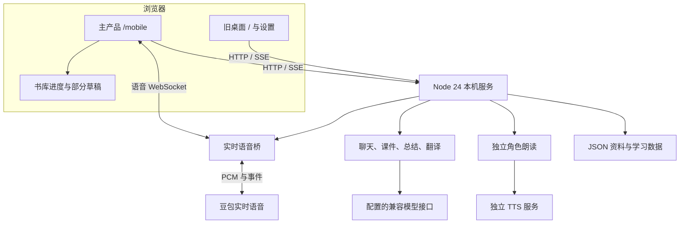
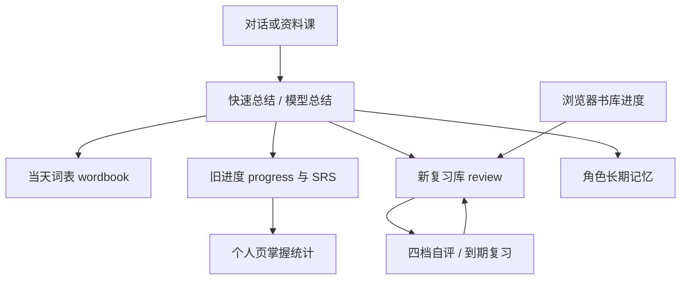

# Ava：代码逆向、产品进度与恢复报告

**审查对象：2026-11-01 交接版；目标账号：`jeusgbhshs-blip`；建议仓库名：`ava-english-tutor`。**

证据来自用户提供的 ZIP、源码逐模块阅读、独立分工交叉核查、原始测试及隔离复现。原始源码已保留在本地基线提交 `725c004`，完整 SHA 与 ZIP 校验值见下文。附录中的文件行号指原始交接代码；修复后的行号可能移动。

## 1. 结论

**项目的核心源码完整，可以直接继续开发。它已经是一套功能较丰富的本机单用户英语学习试用产品；主要问题是主链路稳定性、教学结果可信度与产品工程化。**

1. 清单中的 127 个文件全部存在，大小和 SHA256 前缀全部吻合；加上清单自身，实际 128 个文件。没有发现缺失的运行模块或人物素材。
2. 当前主入口是 `/mobile`，虽然目录叫 mobile，实际设计是桌面优先。旧 `/` 仍承担完整模型设置等功能，不能简单删除。
3. 已实现课程、对话、资料导入、知识库、资料带读、书库、总结和复习；这些模块有真实后端与持久化。
4. 数字人是分层图片与 WebGL 动画；跟读评分是转写文字匹配；课程通过是参与流程规则。不能把三者分别宣传为生成式真人视频、声学发音评测、学习掌握证明。
5. 225 项原单元测试通过，但有些关键错误没有被原测试覆盖。本轮复现了首句丢音路径、漏接播放进度回调、握手挂起、书库重复、KB 假空库、状态倒退与请求导致退出等问题，并做了有限恢复修复。
6. 账号、用户隔离、数据恢复、费用控制和支付尚未实现。源码可以准备公开，服务不能据此直接当成多人在线产品发布。

本报告描述的是**原始进度和可证实边界**。具体已合入的修复、最后一轮测试数字及 GitHub 状态，以 [RECOVERY.md](RECOVERY.md) 为准；下一阶段按 [ROADMAP.md](ROADMAP.md) 验收。

## 2. 交接完整性：到底丢了什么

### 2.1 数量与可复现基线

| 项目 | 本轮核验 |
|---|---|
| ZIP 文件 | `english-tutor-handover-20261101.zip`，3,307,483 字节 |
| 解压文件 | 128 个，5,568,303 字节 |
| 清单核验 | 127 / 127 文件大小和 SHA256 前缀吻合；清单自身未列入它自己的表 |
| 运行 JavaScript | 52 个 `.js` 文件，37,077 行；不含测试、CSS、HTML、文档 |
| 含测试的 JS/MJS | 57 个，52,612 行 |
| 前端 JavaScript | 20 个，27,067 行；原始语法检查全部通过 |
| 前端 import | 38 条实际静态/字面量动态 import，目标均存在 |
| 运行环境 | 本轮 Node v24.22.1、Linux；项目使用原生 ESM 与内置 WebSocket |
| 原始本地提交 | `725c004bc7bd1bfbb215a8cd75cbe6b239c12853`，修复前完整保存 |

ZIP SHA256：

`138d27cd6f817eda63bc326ce8d7e068ab347da6b4fd89b123b922db077f7d8b`

逐文件完整 SHA256 在 [original-source-inventory.json](evidence/original-source-inventory.json)。原交接清单见 [SOURCE-MANIFEST.md](../handover/SOURCE-MANIFEST.md)。

### 2.2 缺失项分类

| 项目 | 状态 | 对继续开发的影响 |
|---|---|---|
| server/lib/content/web/scripts/test | 均包含 | 可直接阅读、启动和修改 |
| 三角色图片、前后景、SVG、图标、动画模块 | 均包含 | 不需要重新生成角色视觉 |
| `docs/assets/` 历史截图 | 交接明确排除 | 旧 README 中图片链接会缺图，不影响运行源码 |
| `test/artifacts/` 旧截图和日志 | 交接明确排除 | 需要重新跑测试生成证据，不能引用旧截图作为当前验收 |
| `data/`、`data-share/` | 交接明确排除 | 没有个人 Key、知识库、计划、记忆和复习记录；这些业务数据不能靠源码反推恢复 |
| 浏览器 localStorage | 不在源码包内 | 原书库进度、部分复习草稿/昵称无法由交接源码恢复 |
| Node 可执行文件、Chrome | 不包含 | 需外部安装；原 README 的“已包含 Node”与包内事实不符，本轮已改当前版说明 |
| 中文文档名 | ZIP 元数据存在编码错显 | 解压时恢复为 `docs/使用说明.md`、`docs/测试报告.md`，字节和清单哈希一致 |

这里的“逆向”是从已有源码恢复架构、状态、行为及真实完成度。没有必要先从渲染页面猜测业务逻辑，也没有证据说明缺了一个隐藏的云后端。

## 3. 产品实际由什么组成

### 3.1 系统拓扑

代码是 Node 原生 HTTP + 浏览器原生 ES Modules，没有 React/Vue 构建链，也没有 npm 运行依赖。这个结构足够支持当前本机试用产品；无 npm 依赖不等于没有平台依赖，图片 OCR 和部分文档提取仍使用 macOS 系统能力。

### 3.2 两套前端的职责

| 路径 | 代码 | 实际作用 |
|---|---|---|
| `/mobile` | `web/mobile.html`、`web/js/mobile/app.js` | 当前主产品，五个 Tab 与通话页 |
| 课程 | `mobile/screens.js`、`mobile/call.js` | 三课计划、顺序解锁、开课/续课 |
| 对话 | `mobile/call.js`、`doubao-voice.js` | 角色场景、PTT、字幕、资料对照、总结 |
| 助手 | `mobile/screens.js`、`lib/assistant.js` | 规则识别学习意图，生成/修改计划，入口导航 |
| 知识库/书库 | `mobile/kb.js`、`library.js`、`book-library.js` | 导入、选材料、每日节选、词汇同步 |
| 复习 | `mobile/review.js` | 到期卡片、草稿恢复、管理和三款小游戏 |
| 我的 | `mobile/screens.js` | 统计、难度、昵称、兴趣；本轮补配置入口 |
| `/` | `web/index.html`、`main.js`、`modes.js`、`store.js` | 旧版功能与完整模型配置；作为过渡入口保留 |
| 角色动画 | `talking-head.js`、`web/avatar/` | 新版分层动画和旧实验头像 |

`mobile/call.js` 原始 4,438 行，承担麦克风、语音、重连、课件、资料定位、动画和总结；`mobile/review.js` 原始 2,534 行，包含词库与游戏。这里的主要工程债是状态耦合和单文件职责过多，暂时没有证据支持先全量重写框架。

### 3.3 后端接口规模

按“方法 + 路由模式”计 **52 个 HTTP 入口**，另有 `/ws/voice`。覆盖设置、内容、聊天、TTS、复习、知识库、兴趣、角色、计划、课程、助手、旧阅读、语音测试、翻译/评分、进度、总结和日词表。完整接口表在 [BACKEND.md](BACKEND.md)。

没有发现登录/注册、会员订单、团队权限、账号级导出删除或多用户管理接口。`/api/health` 主要检查进程存活和配置存在，不能证明凭据有效、音色可用或真实模型质量。

## 4. 主要用户流程与实现程度

### 4.1 个性化课程

用户说学习目标 → 规则识别创建计划 → 立即保存三课骨架 → 后台模型生成课件 → 前端轮询 → 跟读/场景/挑战 → 保存断点 → 完成后解锁下一课。

已有结构化课件、三课进度和断点续学。尚未具备以实际能力测评驱动的自适应课程。修改已有计划的目标或等级时，只改表层计划信息、旧课件未重生成，是仍需修复的问题。

课程推进需要格外准确地解释：原 `call.js` 中跟读连续失败两次也会通过，练习两轮推进，挑战两轮或命中表达就完成。隔离执行原始函数，连续十四次输入无关的 `banana banana` 也能完成五句课程。它可以被设计成低挫败的练习流程，但不能用作“用户已经掌握”的证明。

### 4.2 语音教学

有两条不同的供应商链路：

- 实时通话：16kHz 单声道 PCM 上行；ASR 字幕、老师文本与 24kHz PCM 下行。
- 角色朗读：独立 HTTP TTS 合成 mp3，再交给浏览器播放。

资料课为了避免实时音频读到一半停止，会静音实时下行声音并改走独立 TTS。服务端没有对应关闭上游实时合成，可能发生重复合成；本轮没有测量真实费用，不能承诺具体节省比例。

主界面是点击开始、再点击提交的 PTT 交互。提交时补约 2.4 秒静音以触发 VAD；底层支持实时上下行，不代表用户体验已通过自然全双工验收。

本轮发现的主要逻辑缺陷包括：本地 WS 打开被当成上游就绪、录音过早发送被丢弃、音频进度回调漏接、握手断线后 Promise 不结束、协议错误帧忽略、关闭重复通知。恢复修复与回归见 RECOVERY；真实设备体验仍未验证。

### 4.3 知识库与资料带读

资料提取 → 用户预览校对 → 保存 chunks → 可选模型摘要/关键词增强 → BM25 检索 → 可选查询扩展与重排 → 在提示词中注入材料 → 模型教学 → 文本匹配定位原文 → 课后总结。

本地检索有真实实现，不是仅把“知识库”写进提示词。检索是 BM25，不含向量库；资料模式没有独立答案核验器，不能把“有引用”和“严格资料 prompt”直接当成幻觉已受控的验收。

长文存在两层边界：资料切块保存上限约 60k 字符；实时 persona 最终硬截到 8k。实测 5,600 字材料加角色教学规则会生成 9,548 字 persona，截断后丢掉材料尾部和最近对话。必须把当前句/附近段落/教学游标纳入明确预算，才能稳定教完整长资料。

### 4.4 书库、总结与复习

六本书、每本五段，共三十段内置学习节选。每日课写入知识库，重点词进入复习。原版第五天之后重复同一节，本轮做了跨日与同日幂等回归修复。

挂断先给规则快速总结，再尝试模型总结；关键词同时写入日词表、旧 progress/SRS 和新 review 系统。新旧复习状态并不完全同步：旧系统以盒子等级统计掌握，新系统用 new/learning/known。已掌握词被新总结重新变为 new 的具体错误本轮修复，统一两套状态源仍是后续任务。

书库“学习分钟”是每次首次标完成固定 +10，而非实际计时；书库进度存在 localStorage。换浏览器、清缓存或使用另一设备不自动同步。

## 5. 现有内容与能力边界

| 内置内容 | 源码实数 |
|---|---:|
| 角色 | 3 |
| 角色专属场景总数 | 9（每角色 3） |
| 自由话题 | 8 |
| 角色扮演场景 | 4 |
| 跟读句子 | 34 |
| 主题词汇 | 48 |
| 书库作品/节选 | 6 / 30 |

模型能继续生成内容，不等于已经拥有经过编辑、审校与教学验证的无限课程库。这里的数字只统计随包静态内容。

| 展示概念 | 当前真实含义 | 产品表述应如何收紧 |
|---|---|---|
| 数字人 | 分层图片、WebGL 变形、眨眼呼吸、音量口型 | 可称动态角色，不宣称真人视频生成 |
| 发音评分 | 目标句与 ASR 转写词的对齐、编辑距离与漏词扣分 | 叫“跟读内容匹配”；准确发音/重音/节奏需声学评测 |
| 课程完成 | 步骤推进和参与轮次 | 区分练过、跳过、待复习与真正掌握 |
| 本地知识库 | JSON 存在本机，本地检索 | 调云模型时材料片段、问题、记忆会发到配置的服务商；不能说所有内容永不出本机 |
| 实时语音 | 已接通协议与回合流程 | 真机首字、长音频、回声和弱网尚待验收 |
| Plus | 页面明确占位 | 没有付款、订阅、额度或权益代码 |
| PWA | 有 manifest | 没有 Service Worker，不能据此称完整离线应用 |

源码证据：`lib/score.js`；`web/js/talking-head.js`；`web/js/mobile/call.js`；`lib/kb.js` 的 enrich/search；`server.js` 提示词与模型调用；`screens.js` 的 Plus；`web/manifest.webmanifest`。

## 6. 数据与外部请求：不是只有一张网页

固定业务 JSON 共八个：settings、plans、profile、memory、progress、review、wordbook、kb/index；另有 KB 正文、旧阅读正文和 TTS 缓存。业务 JSON 使用临时文件加 rename，不应误报为“全部非原子写”。

真正缺少的是跨文件事务、异步任务版本检查的全面覆盖、备份/恢复、损坏隔离和多用户一致性。总结要写三份学习数据，任何中断都可能只完成其中一部分；损坏 JSON 会静默回退，后续写入可能覆盖原坏文件。旧计划版本和旧阅读容量还存在自动丢弃规则，需在恢复能力上线前重新设计。

上图解释了为什么“单词出现过”“复习状态”“个人页掌握数”可能不一致。下一阶段应确定权威学习状态源，而不是再叠一套统计。

外部数据实际发送路径：麦克风音频到实时语音供应商；聊天/课件/总结请求到配置的模型接口；部分知识库片段和用户记忆进入这些请求；角色朗读文本到独立 TTS。静态源码交付包没有个人数据，不代表运行时处理完全离线。

## 7. 产品成熟度判断

不采用“完成 80%”之类没有统一分母的数字。按可交付能力分层更准确：

| 层面 | 当前判断 | 验收边界 |
|---|---|---|
| 源码接手 | 完整，可继续开发 | 清单与依赖核验通过 |
| 本机服务 | 可运行 | 真实 HTTP/WS + 假上游已测 |
| 主要功能骨架 | 已形成闭环 | 原版局部逻辑有缺陷，本轮修复部分 |
| 初次配置 | 原主入口缺口，本轮补过渡入口 | 纯逻辑验证，实际浏览器视觉未验收 |
| 真实 AI 口语效果 | 未完成本轮验收 | 无真实凭据/设备测试，不能用假音频替代 |
| 长资料连续教学 | 未完成 | 上下文截断与教学游标问题仍存在 |
| 学习效果证明 | 未完成 | 参与进度不等于掌握，评分没有声学输入 |
| 数据保护与恢复 | 不充分 | 单实例共享、无备份、损坏处理粗糙 |
| 多人在线网站 | 未建立 | 缺账号、隔离、限流、计费和运维 |
| 会员商业化 | 未建立 | Plus 占位，无交易链路 |
| 工程回归 | 已有较多测试，本轮补行为测试和 CI 配置 | 远端 CI 与 UI/真机验收分开计 |

建议把它定位为**值得继续打磨的本地英语互动学习试用产品**。已有大量可复用工作；下一段投入应让已有课堂可靠、可解释、能恢复，而不是先增加角色数或改技术框架。

## 8. 测试证据与限制

### 原始基线

- `npm test`：225 tests / 225 pass / 0 fail。
- `npm run test:e2e`：104 项，102 pass / 2 fail。
- 20 个前端 JS 语法通过；38 条 import 目标存在。
- 原始端到端失败一：PNG OCR 测试默认期待 macOS Vision，但运行环境为 Linux，代码返回明确 400。
- 原始端到端失败二：测试仍要求旧的 Knowledge base material/LENS/Director 文案；现行 grounded 使用 MATERIAL LESSON 并禁用自由聊天导演。材料真实注入，属于合同测试未随设计更新。

本轮把 OCR 测试改为按平台分支：本次实跑 Linux 的明确拒绝分支，macOS Vision 真提取仍待本机验收。同时用真实 fixture 原句、标题、逐句教学、资料限定、反馈格式和“无自由聊天导演”的断言替代旧词面断言。divergent 继续验证身份视角与导演，避免扩大放行。

### 隔离复现

- 第六天继续 Day 5；KB 错误响应清空列表和选择。
- 未收到 ready 已发送 PCM；持续音频的进度回调为零。
- 协议 ERROR 不上报；ready 前关闭导致连接永久 pending；关闭通知两次。
- 已掌握词被新总结变回 new，旧到期日仍在。
- 畸形 Host 导致服务 exit 1。
- 无鉴权的设置测试把假 Key 发到调用者指定的回环接收器；仅使用假 Key 和本机 mock，没有真实凭据外发。

### 本轮没有验证的项目

没有使用真实 DeepSeek/豆包/其他供应商 Key；没有消耗真实 API 额度；没有做真人麦克风、音色、网络中断和五分钟长通话验收。原 UI 套件需要 Chrome/CDP，本轮当前连接不能访问执行环境的 localhost，因此 UI 未被计为通过。静态 DOM 替身测试可以验证点击处理与状态函数，不能替代视觉和真浏览器交互。

GitHub 远端是否已发布、CI 是否执行，必须以 RECOVERY 记录为准。源代码准备好和远端仓库存在是两个独立状态。

## 9. 后续开发的具体顺序

1. 完成本轮已发现的小范围恢复修复，运行原测试和新增行为回归，保留基线证据。
2. 真机验证语音；给连接、采音、识别、回复、播放、挂断建立单一状态合同，记录各段耗时。
3. 资料课改为明确的文档/段落/句子游标，验证长文最后一段和重连后的准确续教。
4. 学习状态统一：练过、跳过、掌握分开；修目标变更的课件重生成；复习和统计使用同一数据源。
5. 备份、恢复、迁移和模型调用来源标识补齐。
6. 再按使用对象引入在线账号、数据隔离、费用控制和收费能力。

每一步具体完成标准见 ROADMAP。本轮没有把上述尚未实现的功能算作已完成。

## 10. 证据索引

- [前端全模块审查](FRONTEND.md)
- [后端接口、数据与安全审查](BACKEND.md)
- [语音与教学逻辑审查](VOICE.md)
- [原始单元测试日志](evidence/baseline-api.log)
- [原始 E2E 日志](evidence/baseline-e2e.log)
- [原始运行探针](evidence/baseline-runtime-probes.json)
- [原始前端依赖核验](evidence/baseline-frontend-static.json)
- [恢复修复与最终测试](RECOVERY.md)

CI 配置方法参考 [GitHub 官方 Node.js 测试文档](https://docs.github.com/en/actions/tutorials/build-and-test-code/nodejs)，没有为运行测试配置真实模型凭据。
